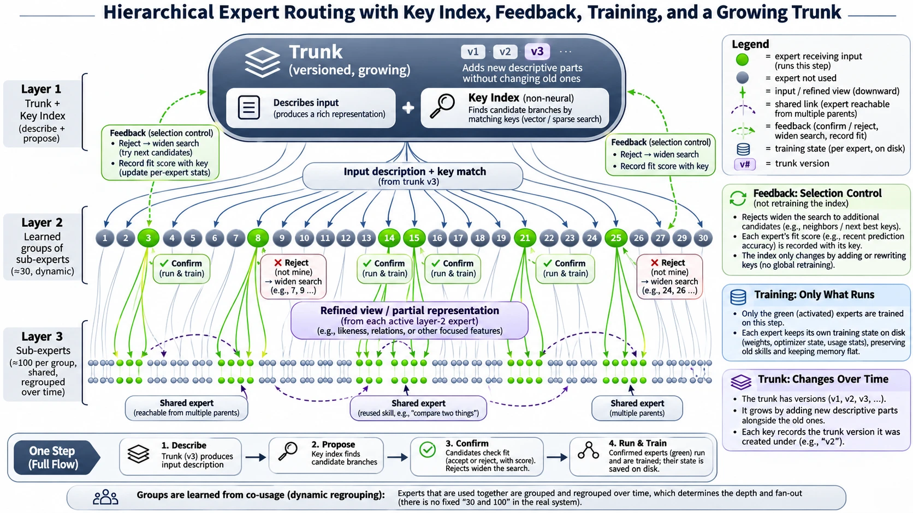

# Neural Computer Agent

An experimental system that learns to reason by growing a library of small
experts instead of training one large model. The whole system can become very
large, but only the few parts needed for the task at hand are loaded into
memory and trained, so it runs on an ordinary computer.

## The goal

Most large models are a single network: to use or train any of it, all of it
must be in memory. This project asks whether a system can instead

- learn many different tasks with as little hand-written, task-specific code
  as possible,
- reuse what it learned on one task to learn the next with fewer examples,
- keep growing without forgetting what it already knows, and
- stay small in memory however much it has learned.

## The idea

One step of the intended design:

1. **Describe.** A small shared *trunk* turns the input into a description.
   It is the only learned part that is always in memory.
2. **Propose.** A *key index* matches that description against a key stored
   for each expert and proposes a few candidates.
3. **Confirm.** Each candidate reports how well it fits, from its own record.
   A rejection widens the search.
4. **Run and train.** Only the confirmed experts run and learn. Their state
   is stored beside them on disk.

The trunk has versions. It grows by adding new parts beside the old ones, so
experts built on an earlier version keep working.

A *kernel* holds this together. Experts never call each other; they declare
what they take and give, and the kernel plans a route through them, loads
them when needed and evicts them when not. The kernel names no task: every
task-specific part lives in a separate package and is installed like any
other expert.

How the agent is meant to think:

- **Working memory.** *Channels* hold what was recently seen, heard and
  done: a frame buffer, an audio buffer and an event buffer. A *scratchpad*
  holds what the agent writes for itself.
- **Long-term memory.** The stored experts and the trunk they read.
- **Concepts.** The input is worked on in steps, one concept after another,
  each free to consult and update both memories. A concept holds hypotheses,
  each something that could be done now with the chance that it is right:
  an output, an asking of the kernel, or waiting.
- **Putting out or thinking on.** After each concept the step is summed up
  as the best hypothesis, the risk of going on and the risk of putting out
  now. The hypothesis is taken where going on is the greater risk;
  otherwise the next concept is asked, or the next step awaited. This is
  the minimum risk-ratio rule of §76.2. The diagram’s decision box uses
  an upper bound on the same ratio. Set `Thresholds(ratio_bound="maximum")`
  to select that rule. A host can set `think(..., passes=n)` to refine the
  same input over at most `n` traversals, sharing one cost budget.

## Status

The diagrams are the target, not a description of what is finished.

- **Built:** the kernel with typed contracts, planning, lazy loading and
  eviction; admission of new experts only on fresh evidence; a trunk kept as
  a library of blocks that are added and never changed, so that every stored
  expert gives what it gave, with a key index over them; a working memory
  of channels for recent frames, sound, presses and payments, with a
  scratchpad of notes; a thinking loop that asks concepts in turn, weighs
  the two risks and serves an asking of the kernel within the step; a large
  body of mathematical results with machine-checked proofs.
- **Under test:** a small learner taught only by reward from the screen,
  choosing between experts by their own record, and how few judgements a
  new task needs; a learner that looks back in the working memory. External
  learners can score the next two presses with a learned successor model,
  request an episodic memory read within a step budget, and use immediate
  reward to relearn which physical control issues a proposed action.
  A frozen learner can also calibrate each visual reader’s early-output
  confidence and risk-ratio bounds from signed rewards and the cost of closer looks.
  An inference-only load can run that policy with a bounded feature window
  and load its decision weights independently of its training history.
  A concept can discover a request from a newly installed manifest, bind it
  to working-memory observations, and ask the kernel to interpret an unfamiliar
  result through a compatible expert. Paired outcomes can rank providers that
  share a contract and estimate when consultation improves a decision.
  With a deterministic transition model and faithful state keys, a concept
  can keep a plan in working memory and revise it when observations diverge.
- **Not built yet:** efficient plan validation from uncertain visual observations; regrouping experts by use; and a search that reaches a first reward where
  random presses do not.

Measurements, including negative results, are in the dated research diary.

## Where to look

| Path | Contents |
|---|---|
| [`src/nca/`](src/nca) | The kernel and its generic runtimes |
| [`THEORY.md`](THEORY.md) | Index of the mathematical chapters in [`theory/`](theory) |
| [`lean/`](lean) | Lean proofs of the theory |
| [`ARCHITECTURE.md`](ARCHITECTURE.md) | How theory, proofs and code correspond |
| [`diary/`](diary) | Predictions, experiments and measurements by date |
| [`docs/Neural-Computer-Agent.md`](docs/Neural-Computer-Agent.md) | The original design specification |
| [`AGENTS.md`](AGENTS.md) | Rules for contributors |

## Getting started

    uv sync
    uv run pytest

The proofs build with `cd lean && lake exe cache get && lake build`. Expert
packages are separate repositories that register themselves through the
`nca.packages` entry-point group; the core does not depend on any of them.
