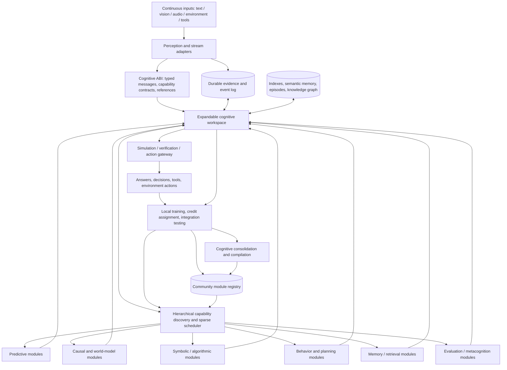

# NCA Neural-Computer Agent: A Modular, Community-Built Cognitive Architecture

**Architecture and research specification — Draft v0.1**  
**Date:** 29 October 2026  
**Status:** Proposed design, not a claim that the architecture has been implemented or that its central hypotheses have been demonstrated  
**Working description:** An open-ended, neuro-symbolic, sparsely executed, independently extensible cognitive operating system

> **Vision:** Build an intelligence that grows through independently trained and developed cognitive components, expands the detail and duration of information it can work with as resources increase, and discovers useful combinations of capabilities without repeatedly retraining a monolithic model.

---

## Contents

1. [Executive overview](#1-executive-overview)
2. [Problem statement and philosophy](#2-problem-statement-and-philosophy)
3. [Goals, non-goals, and architectural invariants](#3-goals-non-goals-and-architectural-invariants)
4. [Top-level architecture](#4-top-level-architecture)
5. [The cognitive microkernel](#5-the-cognitive-microkernel)
6. [Cognitive modules and their taxonomy](#6-cognitive-modules-and-their-taxonomy)
7. [Cognitive ABI and interoperability](#7-cognitive-abi-and-interoperability)
8. [The expandable cognitive workspace](#8-the-expandable-cognitive-workspace)
9. [Arbitrary streams, fidelity, and progressive refinement](#9-arbitrary-streams-fidelity-and-progressive-refinement)
10. [External memory and continuity](#10-external-memory-and-continuity)
11. [Discovery, routing, and sparse execution](#11-discovery-routing-and-sparse-execution)
12. [Composition, planning, and reasoning](#12-composition-planning-and-reasoning)
13. [World modeling and prediction](#13-world-modeling-and-prediction)
14. [Learning without mandatory global backpropagation](#14-learning-without-mandatory-global-backpropagation)
15. [Credit assignment across modules](#15-credit-assignment-across-modules)
16. [An evolving ecosystem of mechanisms](#16-an-evolving-ecosystem-of-mechanisms)
17. [Cognitive compilation and consolidation](#17-cognitive-compilation-and-consolidation)
18. [Compute, performance, and hardware scalability](#18-compute-performance-and-hardware-scalability)
19. [Community training, distribution, and governance](#19-community-training-distribution-and-governance)
20. [Security, isolation, and trustworthy operation](#20-security-isolation-and-trustworthy-operation)
21. [Experimental methodology and success metrics](#21-experimental-methodology-and-success-metrics)
22. [First experimental program: digits to composition](#22-first-experimental-program-digits-to-composition)
23. [Later experiments: streams, memory, and scaling](#23-later-experiments-streams-memory-and-scaling)
24. [Reference implementation and APIs](#24-reference-implementation-and-apis)
25. [Phased roadmap and release gates](#25-phased-roadmap-and-release-gates)
26. [Failure modes and mitigations](#26-failure-modes-and-mitigations)
27. [Open research questions](#27-open-research-questions)
28. [Working decisions and deferred choices](#28-working-decisions-and-deferred-choices)
29. [Glossary](#29-glossary)
30. [Relevant research and precedents](#30-relevant-research-and-precedents)
31. [Final architecture statement](#31-final-architecture-statement)

---

## 1. Executive overview

The **Neural Computer Agent** is a proposal for an extensible cognitive substrate rather than a single foundation model. Its smallest useful constituents are **cognitive modules**: small neural networks, recurrent mechanisms, symbolic algorithms, classifiers, predictors, programs, memory interfaces, planners, learned controllers, or larger models. A module can be created, trained, evaluated, distributed, installed, upgraded, or retired without requiring the whole system to be jointly retrained.

A **cognitive microkernel** supplies the shared services that make those modules cooperate: discovery, routing, scheduling, memory access, budgets, typed communication, provenance, supervision, sandboxing, and lifecycle management. A **Cognitive ABI** is the stable compatibility layer. An **expandable workspace** holds the task state and evolving model of the world. Information remains addressable through persistent evidence and indexes rather than being forced into one fixed-size vector, token window, or internal hidden state.

Intelligence is assembled at runtime: modules perceive parts of a problem, publish hypotheses and transformations, request additional evidence, predict consequences, verify conclusions, and propose actions. A sparse scheduler activates a tiny fraction of the available modules, chooses where detail or reasoning depth should increase, and coordinates their interactions under resource limits. The system learns from outcomes at the level of modules, routers, adapters, and composed skills. Frequently useful combinations may be cached, distilled, or compiled into efficient routines.

The architecture is intended to satisfy four orthogonal forms of growth:

1. **Capability growth:** more independently installed mechanisms enable more skills.
2. **Fidelity growth:** richer representations and finer inspection become possible as storage and compute increase.
3. **Computational growth:** deeper, broader, and more parallel reasoning can be allocated when necessary.
4. **Learning growth:** individual mechanisms and their compositions improve continuously without mandatory global retraining.

The key scientific hypothesis is stronger than "a package system can load multiple models." It is that **independently acquired capabilities can accumulate and generalize compositionally**, with acceptable regressions and bounded coordination costs. This must be tested, not assumed.

### 1.1 The simplest mental model

The system resembles an operating system in which:

- The **microkernel** provides scheduling, resource control, and trusted interfaces.
- **Cognitive modules** resemble installable programs, services, algorithms, and devices.
- The **Cognitive ABI** resembles an extensible, typed interprocess protocol.
- The **workspace** resembles memory plus a structured shared data substrate.
- The **evidence store** resembles durable files, event logs, and addressable media.
- The **module registry** resembles a package manager and capability directory.
- **Learning and evaluation** resemble continuous integration, optimization, and empirical science.
- **Cognitive compilation** resembles specialization, caching, and optimizing frequently used programs.

This analogy has limits. Intelligence depends on uncertainty, incomplete world models, conflicting hypotheses, and learned coordination. The ABI must therefore express more than deterministic function arguments and return values.

### 1.2 What is fixed, and what may change?

**Intended to remain stable:** the interface model, resource and trust boundaries, versioning rules, provenance expectations, and the ability to preserve and address information.

**Intended to be replaceable:** particular model architectures, training algorithms, encoders, representation adapters, optimizers, schedulers, world models, reasoning systems, and even parts of the microkernel behind compatible interfaces.

The goal is **a durable architecture for future discoveries**, not a commitment to transformers, backpropagation, one embedding dimension, or any present-day frontier-model design.

---

## 2. Problem statement and philosophy

### 2.1 The problems with a monolithic approach

Conventional large foundation-model development has important strengths, but it is often organized around tightly coupled parameters and coordinated training runs. A community member cannot necessarily train a tiny independently useful expert, install it into a deployed model, and expect reliable behavior without compatibility work or global fine-tuning. Model width, hidden-state dimensions, context windows, and tokenization choices can become strong architectural constraints. Even sparse MoE models commonly train experts jointly around common representations.

A community-built general agent needs a different development model: **small contributions must remain individually valuable while also participating in larger cognitive structures**.

### 2.2 Core thesis: an intelligence is a process, not a fixed tensor

The architectural unit of general intelligence should not be one neural tensor of a predetermined size. It should be an executable process that can:

1. Observe or receive ongoing information.
2. Allocate attention to some part of that information.
3. Retrieve or expand relevant persistent state.
4. Invoke appropriate computational mechanisms.
5. Construct, test, revise, and verify hypotheses.
6. Act or produce an answer.
7. Learn from consequences.
8. Repeat, potentially indefinitely while resources and operation permit.

A small mechanism may operate on huge problems through repeated operations over external state, just as a fixed sorting program can process larger collections when memory and time permit.

### 2.3 Community development is a technical requirement

Decentralized participation is not only a licensing or governance matter. It implies that modules must have **independent trainability, stable contracts, reproducible tests, substitutability, discoverability, and isolation**. If every meaningful improvement requires a synchronized global training run, the architecture has failed an essential goal.

### 2.4 Radical algorithms are welcome

Backpropagation may be excellent for training a local perception module. Evolutionary search may be effective for discovering new mechanisms. Program synthesis may create exact algorithms. Bayesian inference may track uncertain beliefs. Predictive coding or local losses may permit modular continual learning. The architecture should allow all of these to coexist. It does **not** presume that a wholly backpropagation-free approach is automatically better.

### 2.5 Scientific humility

Nothing in this specification establishes that a million independently trained modules will become AGI, that local learning will beat global training, or that a shared ABI will solve representation alignment. The architecture is a coherent set of **design requirements, interfaces, hypotheses, and experiments** intended to make these questions testable.

---

## 3. Goals, non-goals, and architectural invariants

### 3.1 Primary goals

| ID | Requirement | Interpretation |
|---|---|---|
| G-01 | Independent contribution | A contributor can train and publish a module without retraining unrelated modules. |
| G-02 | Composition | New modules can cooperate with existing modules through public contracts. |
| G-03 | Capability accumulation | Installing useful modules improves the combined system, not merely an isolated demo. |
| G-04 | Sparse execution | The entire installed library does not execute for each observation. |
| G-05 | Flexible internals | Neural, symbolic, statistical, learned, and hand-written components can coexist. |
| G-06 | Expandable representations | No mandatory fixed-size, lossy, global bottleneck for all task information. |
| G-07 | Unbounded-in-principle streams | Continuous input can be consumed incrementally over arbitrary durations if resources grow accordingly. |
| G-08 | Progressive fidelity | Important regions, events, and hypotheses can be refined selectively. |
| G-09 | Externalized memory | Knowledge and evidence can outlive processes, controllers, and module upgrades. |
| G-10 | Adaptive compute | The system chooses compute depth, breadth, and precision under explicit budgets. |
| G-11 | Local learning | Components can improve without requiring differentiation through the entire system. |
| G-12 | Empirical accountability | Gains, costs, regressions, and compositional generalization must be measurable. |
| G-13 | Long-term extensibility | Better future algorithms and hardware can be integrated without rewriting the conceptual architecture. |
| G-14 | Open development | Forking, reproducible integration, independent evaluation, and transparent governance are first-class. |
| G-15 | Trust boundaries | Untrusted models, data, and code cannot silently obtain unrestricted execution privileges. |

### 3.2 Non-goals

- Do not build a frontier-scale monolithic base model as the first step.
- Do not declare modular composition solved because a hard-coded pipeline works.
- Do not require one canonical global vector embedding or neural width.
- Do not require every module to be differentiable, or reject backpropagation where it works.
- Do not equate a large module count with intelligence.
- Do not promise literal infinite memory, zero-cost computation, or perfect retention on finite hardware.
- Do not treat model confidence as mathematical proof.
- Do not make externally contributed code trusted merely because it is open source.
- Do not build a complicated distributed production platform before proving the basic scientific hypotheses.

### 3.3 Architectural invariants

**INV-01 — No compulsory global finite context:** A module may have a finite context window, but the system's represented history may be addressably larger, with an expandable store and processing procedures.

**INV-02 — No compulsory global latent bottleneck:** Local compressed representations are fine; no single fixed-width summary may be the only surviving record of arbitrarily complex input.

**INV-03 — Stable, versioned contracts:** Modules communicate through declared, checked semantics; internal implementation details are not the ABI.

**INV-04 — Explicit provenance:** Outputs that assert knowledge or facts have links to their derivation, assumptions, and/or originating evidence when possible.

**INV-05 — Explicit resource accounting:** Module invocations, storage growth, refinement work, and remote calls consume tracked budgets.

**INV-06 — Isolation of trust:** A capability to propose an action does not imply permission to execute it.

**INV-07 — Inspectable decisions:** Routing, module choice, failures, and evaluation results are reproducible and logged at a suitable level.

**INV-08 — Upgrade without erasure:** Upgrading a recognizer or controller should not inherently discard persistent experiences or knowledge.

**INV-09 — Reversible integration:** An installation or training update can be disabled, rolled back, or compared with the prior version.

**INV-10 — Measured composition:** Architectural claims must be judged against held-out tasks and monolithic or pipeline baselines.

---

## 4. Top-level architecture



### 4.1 Four conceptual planes

1. **Data plane:** input streams, evidence, event logs, structured workspace, memories, artifacts, and derived representations.
2. **Execution/control plane:** microkernel, module invocation, routing, scheduling, resource budgets, dependency handling, and actions.
3. **Learning plane:** local optimizers, reward and prediction feedback, credit assignment, module evolution, adapter training, and consolidation.
4. **Community/trust plane:** module publication, reproducible builds, evaluation, signatures, compatibility, distribution, security, and governance.

These planes have different stability requirements. Training code may be experimental; an ABI and persistent evidence format need more conservative versioning.

### 4.2 Operational cycle

1. A stream adapter records an observation and publishes a typed event.
2. The workspace references the event and updates relevant task state.
3. The scheduler considers unresolved goals, changes, opportunities, and expected module utility.
4. Candidate modules read specific references, not automatically the entire world state.
5. They publish predictions, edits, results, questions, proposed actions, or refinement requests.
6. A validator checks schemas, permissions, consistency, and available proof obligations.
7. The workspace commits approved changes; dependencies are updated.
8. The scheduler decides whether additional processing is useful.
9. Authorized actions are executed; their actual outcomes are observed.
10. Learning and evaluation receive outcome records; changes remain versioned and reversible.

### 4.3 Not a mandatory sequential pipeline

The diagram suggests a flow, but the execution model is an **event-driven, potentially cyclic dataflow graph**. Many modules may operate concurrently. One module may request more perception, another may verify an existing hypothesis, and a third may maintain a long-running temporal model. The scheduler must enforce budget and termination policies for recursive or cyclic workflows.

---

## 5. The cognitive microkernel

### 5.1 Responsibilities

The microkernel should be intentionally small. Its required responsibilities are:

- **Identity and discovery:** resolve module IDs, capabilities, versions, dependencies, and resource requirements.
- **Invocation:** instantiate, call, batch, suspend, resume, cancel, and terminate modules.
- **Scheduling:** allocate time, memory, GPU/CPU work, power, priority, and attention.
- **Workspace transactions:** authorize typed reads, writes, claims, retractions, and dependency updates.
- **Communication:** deliver events, results, and streaming messages through the ABI.
- **State management:** persist checkpoints, restore module state, and isolate sessions.
- **Security:** enforce capabilities and permissions; sandbox untrusted code and data.
- **Observability:** record causal invocation traces, performance, outcomes, and failures.
- **Version compatibility:** validate contracts and negotiate adapters.
- **Failure handling:** enforce deadlines, retries, fallbacks, circuit breakers, and rollback.

It should **not** require a single blessed perception model, planner, world model, optimizer, or representation.

### 5.2 Minimality versus intelligence

In the initial prototype, the scheduler may be a deterministic rule engine. Later, learned schedulers and metacognitive modules may propose better choices. The kernel should remain a trusted resource arbiter even if routing intelligence is provided by untrusted or experimental learned modules.

Recommended separation:

- **Policy suggestion:** a learned router proposes module invocations and budgets.
- **Policy enforcement:** the microkernel checks authorization, availability, quotas, and hard safety constraints.

This prevents a self-modifying learned component from bypassing the trusted operating boundary.

### 5.3 Processes, instances, and supervision

A module *package* is not the same as a running *instance*. Multiple instances of the same neural mechanism may process different scenes, agents, or hypotheses. State can be:

- **Stateless/pure:** output determined by provided inputs and model version.
- **Ephemeral:** local state lives for one invocation or task.
- **Session-persistent:** state survives many calls within a session.
- **Durable:** explicit checkpoint and migration hooks persist state independently.

Supervision policies control crashing, hung or looping modules. The kernel must not assume a model terminates correctly or returns sensible output.

### 5.4 Microkernel compatibility promise

The real compatibility promise is **behavioral and contractual**, not binary forever. ABI versions may evolve. Stable interfaces must support feature negotiation, migrations, deprecation windows, and multiple versions installed concurrently.

---

## 6. Cognitive modules and their taxonomy

### 6.1 What is a module?

A **cognitive module** is a separately packaged computational capability with a declared contract. It is not necessarily a neural network, and it is not necessarily a human-recognizable specialty. A module can be an algorithm, local predictive learner, world-model primitive, retrieval function, verification tactic, policy, learned controller, or complex model.

Each module declares at least:

- Stable identity, version, author/publisher, and integrity hashes.
- Input and output schemas and compatible interface versions.
- Capabilities, assumptions, domains, limitations, and failure modes.
- Whether it is pure, probabilistic, stateful, trainable, or side-effecting.
- Training method and distribution artifact where applicable.
- Estimated latency, memory, energy, throughput, and accelerators.
- Security and sandboxing needs; whether remote calls are allowed.
- Evaluation results and conditions under which they were measured.
- Dependencies, optional adapters, and compatible data/representation revisions.
- Licensing, provenance, and reproducibility metadata.

### 6.2 Principal module families

| Family | Responsibilities | Possible internal implementations |
|---|---|---|
| Perception | Detect and transcribe signals; spatial/temporal segmentation | CNNs, transformers, recurrent nets, classical vision, signal processing |
| Predictive | Forecast changes and unseen states | Local recurrent learners, probabilistic models, system identification |
| Causal | Represent intervention-relevant relations | Structural causal models, simulation, search, learned dynamics |
| Algorithmic | Exact or approximate transformations | Code, theorem provers, search algorithms, learned programs |
| Behavioral | Select actions and reusable skills | RL policies, planners, control theory, heuristics |
| Memory | Store, retrieve, index, reconcile | B-trees, vector search, graphs, databases, recurrent retrieval models |
| Evaluative | Check outcomes, preferences, costs, uncertainty | Verifiers, critics, reward models, formal contracts |
| Metacognitive | Allocate attention, reasoning, and learning effort | Bandits, decision models, learned routing, search policies |
| Adapters | Convert between representations | Parsers, type-preserving mappers, embedding translators |
| Consolidators | Fuse and optimize repeated compositions | Program synthesis, distillation, partial evaluation, compilation |

### 6.3 Hierarchical granularity: a mixture of potentially unlimited experts

There are at least three scales of expert:

**Level A — Micro-experts:** Tiny fast mechanisms invoked frequently, potentially grouped into large indexed collections. Their execution should avoid per-expert process startup, network round trips, and tiny GPU kernels. Batching and co-location are essential.

**Level B — Independently installable modules:** Domain-capable learned or symbolic components with ABI manifests; trainable by individual contributors and reusable in many tasks.

**Level C — Higher-level services:** Large specialist models, external theorem provers, simulators, remote models, and tools. These are useful but may carry high latency and different trust or privacy boundaries.

All levels may be supported simultaneously. **A large language model is an optional module or interface, not the required foundation of the architecture.**

### 6.4 Module independence is a spectrum

A useful classification is:

- **Strictly independent:** trained without the weights or training datasets of neighboring modules; only the public ABI and task semantics are known.
- **Adapter-dependent:** independently trained internally but requires a small calibration adapter.
- **Co-adapted:** benefits from training against a published, frozen set of other modules or routing examples.
- **Jointly trained:** requires end-to-end or synchronized training; permitted as a specialized composite, but not counted as proof of independent composability.

Benchmarks should report the independence level instead of collapsing all four into "modular."

### 6.5 Functional rather than exclusively semantic specialization

We should not demand that every module be labeled "mathematics," "vision," or "language." Modules might specialize in primitives such as:

- Detect change.
- Compare two regions.
- Track identity across frames.
- Predict a state transition.
- Detect contradictions.
- Expand a subgoal.
- Compress a successful behavior sequence.
- Estimate whether further inspection is valuable.

This supports emergent compositionality instead of relying entirely on human-designed domain boundaries.

---

## 7. Cognitive ABI and interoperability

The **Cognitive Application Binary/Behavioral Interface (Cognitive ABI)** is the foundation of community compatibility. In early versions it may be an in-process typed API or serialized protocol rather than a literal traditional machine-code ABI. The term denotes stable cross-module contracts.

### 7.1 Three complementary interfaces

**Symbolic:** typed values, predicates, entities, relations, expressions, programs, constraints, proofs, causal claims, and structured events.

**Neural:** tensors, embeddings, feature maps, activations, distributions, and other learned representations, each with explicit shapes, semantic meaning where known, encoding/version IDs, and adapter requirements.

**Behavioral:** goals, observations, proposed actions, preconditions, predicted consequences, authorization requirements, and observed outcomes.

A fourth cross-cutting concern is **evidence and memory references**, which makes large data addressable without transmitting it through every module invocation.

### 7.2 Canonical envelope

Every message should carry a stable envelope, regardless of payload type:

```yaml
message_id: "msg:01ABC..."
abi_version: "0.1"
message_type: "claim.proposed"
producer:
  module_id: "org.example.digit-reader"
  module_version: "1.0.0"
  instance_id: "run:9842"
execution:
  task_id: "task:128"
  trace_id: "trace:44"
  parent_message_ids: ["msg:input:12"]
  created_at: "2026-10-29T12:00:00Z"
  deadline: null
context:
  workspace_id: "workspace:session-3"
  object_refs: ["evidence:image:22#region-4"]
  schema_id: "cognitive.symbol-hypothesis.v1"
trust:
  origin: "module-output"
  evidence_refs: ["evidence:image:22#region-4"]
  permissions_used: ["workspace.read.region"]
payload:
  hypotheses:
    - symbol: "7"
      confidence: 0.94
    - symbol: "1"
      confidence: 0.04
```

This is an **illustrative schema**, not a finalized wire specification. Numeric confidence is not automatically well-calibrated; calibration must be tested.

### 7.3 Core semantic kinds

The initial type system should support at least:

| Kind | Meaning |
|---|---|
| `EvidenceRef` | Stable reference to original or recorded information, optionally scoped to a region and time interval |
| `Observation` | A typed received measurement, including origin, timing, and metadata |
| `Entity` | Identified object, concept, agent, region, or event with a stable identity |
| `Relation` | Typed relationship between entities |
| `Hypothesis` | Uncertain proposition with confidence, scope, and provenance |
| `Fact` | Accepted claim under explicit evidence and acceptance policy, not metaphysical certainty |
| `Constraint` | Requirement, restriction, or assumption to be satisfied |
| `Goal` | Desired state or objective, possibly hierarchical |
| `Prediction` | Proposed future or hidden state with horizon and uncertainty |
| `StatePatch` | Guarded addition, update, withdrawal, or retraction of workspace claims |
| `ActionProposal` | Proposed side-effecting operation and expected effects |
| `Outcome` | Observation of what actually happened after an action |
| `RefinementRequest` | Request for increased spatial, temporal, semantic, or inferential resolution |
| `ComputeRequest` | Request for extra search, depth, instances, or memory |
| `ProofArtifact` | A checkable derivation, certificate, witness, or proof obligation when applicable |

### 7.4 Contracts

A module advertises **preconditions** (input schema, representation assumptions, resource requirements), **postconditions** (output schema and guarantees where available), and **non-guarantees** (known domain boundaries, accuracy constraints, inability to certify truth).

Two modules compose automatically only when output and input types, semantics, trust requirements, and relevant assumptions match; otherwise an explicit compatible adapter is necessary.

### 7.5 Typed neural data

Never equate two tensors solely because both have shape `[512]`. A neural message should include:

- Model family and feature-space identifier.
- Encoder version and normalization scheme.
- Tensor shape, dtype, layout, precision, and coordinate metadata.
- Whether the representation is comparable, composable, or decodable.
- Calibration and distribution-shift conditions where known.
- Available translation/adaptation modules.

For example, a `visual_object_embedding:v3` and `motor_state_embedding:v2` are different types even if their byte shapes match. A learned adapter may connect them, but that adapter is a tested module with its own version and failure conditions.

### 7.6 Cross-module request/response model

Suggested initial operations:

```text
registry.discover(goal, available_inputs, constraints) -> CandidateModules
module.describe(id, version) -> ModuleManifest
module.invoke(id, input_refs, budget, snapshot) -> ResultStream
workspace.read(ref, projection, authorization) -> Value | Stream
workspace.propose(patches, preconditions) -> ProposalId
workspace.commit(proposal_id) -> CommitResult
workspace.request_refinement(ref, detail, budget) -> NewRefs | Pending
runtime.checkpoint(instance_id) -> DurableStateRef
runtime.cancel(invocation_id) -> CancellationResult
```

Invocations should be asynchronous in the general design. In the first prototype, synchronous in-process calls are sufficient if the contract anticipates future streaming/cancellation.

### 7.7 Composition compatibility

Compatibility requires more than syntactic schemas. For example, a digit recognizer outputting a probability over `{0,…,9}` is not equivalent to a text recognizer outputting arbitrary Unicode strings. A parser consuming ordered symbols also needs layout or ordering metadata.

Therefore the ABI must support:

1. **Structural compatibility:** fields, shapes, and wire formats match.
2. **Semantic compatibility:** the meaning and units match.
3. **Behavioral compatibility:** the module operates acceptably on the intended input distribution.
4. **Security compatibility:** its required permissions and trust level are allowed.
5. **Operational compatibility:** latency, memory, and accelerator requirements fit.

### 7.8 ABI evolution

Use semantic versioning or another explicit compatibility policy, plus capability negotiation. Avoid global migrations that require every published module to be rebuilt at once. Adapters must themselves be measured, cached, and retired when redundant.

---

## 8. The expandable cognitive workspace

### 8.1 Purpose

The workspace is a shared, structured, **expandable cognitive state**. It is not one tensor or an indefinitely growing prompt. It contains the currently relevant model of the task, intermediate results, plans, evidence pointers, uncertainties, and dependency relationships.

It should be possible to inspect an object coarsely, request more detail, introduce new subobjects, construct multiple competing explanations, and retain links back to source evidence.

### 8.2 Data organization

A useful conceptual arrangement is:

```text
Workspace
├── Tasks and goals
├── Entities and object identities
├── Relations and causal hypotheses
├── Observations and evidence references
├── Derived representations (graphs, regions, embeddings)
├── Predictions and counterfactual branches
├── Plans and candidate action sequences
├── Intermediate computations and proof obligations
├── Unresolved questions / refinement requests
└── Invocation, learning, and provenance metadata
```

This may be implemented as several databases plus a transactional abstraction. **Do not require every payload to be stored in a single graph database or semantic format.**

### 8.3 Claims are not necessarily truths

The workspace must distinguish:

- Raw evidence (what was recorded).
- Perception output (what a module inferred from evidence).
- Uncertain belief (what may be true).
- Verified conclusion (what satisfies a specified checker or contract).
- Hypothetical state (what would be true under an assumption).
- Outdated or retracted claim.

A contradictory pair of hypotheses should not be silently overwritten; it may need to persist until disambiguated.

### 8.4 Versioning and consistency

Initially use immutable event records and versioned state snapshots. Proposed workspace updates should be checked and committed atomically where required, with optimistic concurrency or transactions for conflicting writes.

Each committed update records causal parents, the module version, time, confidence/verification status, and the evidence it depends upon. If upstream evidence is invalidated, dependent claims can be marked stale and re-evaluated.

### 8.5 Locality and working sets

A module should read the smallest relevant view:

- A subgraph concerning two objects.
- A rectangular image region at a particular resolution.
- A five-second audio segment.
- A particular event interval.
- A bounded set of candidate hypotheses.

The workspace can be very large while active computation remains small. This is central to avoiding a fixed global context window.

### 8.6 Extensible schema without unlimited ambiguity

Contributors should be able to add new kinds of relations and observations. However, untyped free-form key/value dumps cannot be the sole interoperability mechanism. Provide a small stable vocabulary, namespaced extensions, schema registries, type checking, and explicit conversion modules.

---

## 9. Arbitrary streams, fidelity, and progressive refinement

This section captures one of the project's **non-negotiable differentiators**: the system should accept ongoing streams and scale represented detail without a fixed architectural ceiling.

### 9.1 Clarify the claim

**Arbitrary-length streams** means the processing protocol does not require an entire stream to fit into a model-wide context window. **Arbitrarily improvable fidelity** means more detailed representations can be allocated as input quality, storage, and compute allow. Neither statement promises literal infinity, zero loss on finite hardware, or unlimited throughput.

For a stream with sustained arrival rate `R` bytes/s and retained data duration `T`, raw storage generally grows at least with the incompressible information content of the stream, often on the order of `R × T` before compression, indexing, and replication. If ingestion exceeds sustainable processing or storage capacity, the system must buffer, throttle, spill, apply explicit retention policies, or report dropped data.

### 9.2 Separate evidence, understanding, and attention

Use three layers:

1. **Original evidence:** original text bytes, image frames or reversible deltas, audio samples, sensor records, timestamps, and source provenance, subject to explicit retention rules.
2. **Indexed understanding:** scene graphs, event graphs, extracted objects, temporal relationships, metadata, summaries, and learned embeddings.
3. **Active attention:** selected subsets in RAM or accelerator memory for present reasoning.

An old observation can be removed from active attention without being erased from persistent evidence. A new perception module can later reinterpret it more accurately.

### 9.3 Progressive refinement

Every representation should admit a mechanism for requesting more detail where meaningful:

```text
Video stream
  -> coarse event summary
      -> selected timestamp range
          -> keyframes or exact decoded frames
              -> region of interest
                  -> object boundary, text, motion, depth, etc.
```

```text
Text corpus
  -> document inventory
      -> section summaries
          -> exact paragraphs
              -> exact source bytes and offsets
```

```text
World model
  -> room
      -> objects
          -> individual object components
              -> high-resolution geometry or physical properties
```

Fidelity is multidimensional: spatial, temporal, spectral, symbolic, semantic, probabilistic, causal, and inferential. Each refinement request should declare **what is being refined** and **what additional information or computation is needed**.

### 9.4 A refinement protocol

```yaml
kind: refinement.request
subject: "evidence:video-17#t=24.10..24.60"
axis: "spatial"
requested:
  region: [120, 80, 520, 340]
  representation: "source_pixels"
  max_loss: "none"
budget:
  max_bytes: 50000000
  max_compute_ms: 500
reason: "Read the text on a moving panel"
```

If source pixels were never recorded at sufficient resolution, the system can request a new observation or estimate missing detail while labeling it as inferred. **It must never present hallucinated refinement as recovered evidence.**

### 9.5 Real-time streams

Stream adapters need timestamps, sequence numbers, source IDs, clock alignment policy, ordering semantics, backpressure, and gap detection. Continuous input may be processed in time windows, event-triggered segments, or recurrent state updates. A system that pauses to think still needs a defined policy for preserving newly arriving events.

### 9.6 Lossless visual-stream optimization

For a desktop computer agent, a useful optional visual encoding uses keyframes plus reversible deltas:

- **SAME:** a region is unchanged.
- **SHIFT:** a region has moved by a known offset.
- **ROWS/tiles:** changed regions are encoded directly.
- **KEYFRAME:** a full state is periodically recorded to bound replay cost.

This is a proposed encoding family rather than a required specific codec. Reversible visual compression, when valid, can reduce bandwidth while preserving exact reconstruction. The original reconstruction must be independently tested; lossy semantic summaries must not be confused with lossless records.

### 9.7 No one mandatory resolution

Modules may have fixed receptive fields or local tensor dimensions. They operate over tiles, patches, recursive regions, or addressable subgraphs. Higher fidelity means more units, more repeated operations, or specialized processors—not necessarily a wider global model.

### 9.8 Cost-aware detail allocation

The scheduler may estimate:

`expected refinement value ≈ probability(detail changes decision) × consequence − resource cost`

This is a heuristic objective, not an exact formula for intelligence. It should learn when more precision matters and when coarse information is enough. Tests must verify that it actually exploits added resources and does not merely consume them.

---

## 10. External memory and continuity

### 10.1 Separate controller from knowledge

A small controller must be able to work with a large persistent knowledge store. A module's weights should not be the only place where the agent's accumulated experiences live. This makes it possible to replace controllers, train modules locally, and extend the memory of an agent without increasing every module's parameter count.

### 10.2 A memory hierarchy

| Tier | Typical contents | Lifetime and role |
|---|---|---|
| Registers/ephemeral state | Activations, small local state, temporary tensors | Single invocation or short computation |
| Active workspace | Current entities, plans, selected evidence | Current task/session, demand-loaded |
| Episodic memory | Dated events, actions, outcomes, interactions | Across sessions, recall by time and context |
| Semantic memory | Generalized facts, abstractions, relationships | Longer-lived, versioned and revisable |
| Procedural memory | Skills, programs, compiled plans, policies | Reusable behaviors with measured conditions |
| Evidence archive | Original source material and immutable provenance | Durable within explicit retention policy |
| Module/model storage | Weights, adapters, optimizers, test metadata | Versioned and independently replaceable |

This resembles a **volatility hierarchy**: fast and disposable state near computation, increasingly durable state farther away. It is not necessary to copy the exact hierarchy of physical hardware into the logical model.

### 10.3 Retrieval is a cognitive operation

Memory retrieval should itself be modular. Exact indexes, vector retrieval, graph traversals, symbolic queries, temporal search, and learned retrieval policies can compete or cooperate. Each returns results with provenance, scope, confidence, and cost.

### 10.4 Remembering, correction, and forgetting

The system must support:

- Add, merge, revise, retract, and invalidate knowledge.
- Resolve conflicting evidence and beliefs.
- Delete sensitive data according to policy, including derived representations as far as practical.
- Time-to-live, compaction, retention class, and provenance-aware cleanup.
- Replay or regeneration of derived information from preserved evidence.
- Distinguish forgetting from failed retrieval.

### 10.5 Controller-transfer experiment

One useful proof-oriented experiment is to train a fixed-size controller to store and use knowledge about a procedurally generated world. Then:

1. Grow the world from dozens to thousands or more objects without enlarging the controller.
2. Save the external memory and reset the controller's transient state.
3. Restore that memory with an identical controller copy.
4. Test whether relevant accumulated knowledge persists.
5. Modify or remove facts and check whether retrieval respects those changes.
6. Repeat with a compatible but newly trained controller.

Success would support **externalized cognitive state**. It would not alone prove general reasoning or universal scale generalization.

---

## 11. Discovery, routing, and sparse execution

### 11.1 Why routing is central

An open library may contain thousands, millions, or more candidate modules. Invoking all of them is impossible or wasteful. We require a learned or learnable mechanism for selecting a tiny relevant subset, but the selection mechanism itself must not require linearly examining every heavyweight module on each step.

### 11.2 Hierarchical retrieval

A proposed hierarchy:

1. **Goal and type filtering:** exclude modules with incompatible input/output contracts or unmet assumptions.
2. **Capability retrieval:** obtain candidates through lexical/schema indexes, hierarchical taxonomies, and optionally approximate nearest-neighbor search.
3. **Context-sensitive reranking:** estimate relevant accuracy, previous success, uncertainty, trust, availability, and runtime cost.
4. **Composition search:** identify short chains or small graphs of compatible outputs and inputs.
5. **Resource allocation:** schedule a subset subject to time, memory, and policy constraints.
6. **Post-execution feedback:** update relevance estimates, calibration, and observed costs.

The index can grow without loading every model into active accelerator memory. Approximate indexes trade discovery recall for cost and must be benchmarked.

### 11.3 Scheduler objectives

A stylized ranking is:

\[
U(m \mid s,g) = \mathbb{E}[\Delta\operatorname{quality}\mid s,g,m]
-\lambda_t\mathbb{E}[\operatorname{latency}]
-\lambda_c\mathbb{E}[\operatorname{compute}]
-\lambda_e\mathbb{E}[\operatorname{energy}]
-\lambda_r\operatorname{risk},
\]

where `s` is current state and `g` is the goal. The score is an approximation learned from data or specified by policy; true marginal quality is generally unknown until after execution.

Alternative multiobjective schedulers may optimize Pareto trade-offs or explicit budgets rather than combining all criteria into one scalar.

### 11.4 Pseudocode

```python
# Illustrative scheduler, not a production implementation.
while task.is_active():
    events = workspace.pending_events(task.id)
    goals = workspace.unresolved_goals(task.id)
    candidates = registry.discover_by_contract(events, goals)
    candidates = candidate_index.retrieve_and_rerank(candidates, task)

    plan = scheduler.choose_invocations(
        candidates=candidates,
        workspace=workspace.snapshot(task.id),
        budgets=budget_manager.remaining(task.id),
        dependency_graph=workspace.dependencies(task.id),
    )

    results = runtime.execute_compatible_batches(plan)
    accepted = validator.check(results, workspace, policy)
    workspace.commit(accepted)
    learning_log.record(plan, results, accepted)

    if workspace.goal_satisfied(task.id) or budget_manager.exhausted(task.id):
        task.finish_or_suspend()
```

### 11.5 Resource-aware execution

- Co-locate and batch micro-experts to avoid tiny GPU launch overhead.
- Cache hot weights and memory regions; demand-load cold ones.
- Prefer local fast experts for high-frequency operations.
- Use remote services primarily at coarse task boundaries, where latency is acceptable and disclosure is authorized.
- Support cancellation, timeouts, speculative parallelism, and early stopping.
- Use work-stealing or dependency-graph scheduling when parallel opportunities exist.
- Track memory movement, not just arithmetic FLOPs.
- Keep a robust fallback when learned routing fails or index coverage is incomplete.

### 11.6 Avoid pathological routing

Common issues include expert collapse, overuse of popular modules, neglected specialists, route oscillation, hidden dependency cycles, and too many cheap modules generating noisy hypotheses. Candidate strategies include diversity-aware exploration, minimum useful support, quotas, calibrated confidence, cooldown periods, dependency constraints, and empirical load balancing.

### 11.7 Sparse does not mean free

As module count rises, storage, indexing, compatibility checks, and discovery can still become expensive. The target is **sublinear or slowly growing active execution under suitable workloads**, not a universal mathematical guarantee of constant total cost regardless of library size or task complexity.

---

## 12. Composition, planning, and reasoning

### 12.1 Two forms of intelligence accumulation

**Additive:** Installing a letter recognizer beside a digit recognizer expands the set of recognized symbols.

**Compositional:** A digit recognizer, operator recognizer, layout parser, and symbolic arithmetic module solve handwritten expressions even though the modules were independently trained and no joint handwritten-arithmetic training was used.

The second is more demanding and more scientifically interesting. It must not be confused with merely wiring a manually scripted pipeline.

### 12.2 Composition as typed graph construction

A computation is a graph of module invocations and workspace transformations:

```text
ImageRegion
  -> SymbolHypothesis[]
  -> OrderedTokens
  -> ExpressionAST
  -> NumericResult
  -> Answer
```

If a module's output contract matches another's input contract, the composition engine may propose the edge. If not, it can search for a suitable adapter or request additional representation refinement.

### 12.3 Planning horizon and depth

The planner should support:

- Goal decomposition.
- Backward chaining from required outputs to available input capabilities.
- Forward execution when useful events arrive.
- Partial-order plans when independent steps can run concurrently.
- Recovery and replanning after failures.
- Counterfactual simulation with separately labeled hypothetical states.
- Verification of preconditions and postconditions.
- Tool invocation via an authorization gateway.

No one algorithm must perform all of these operations.

### 12.4 Reasoning modes

**Exact:** Arithmetic, parsing, deterministic transformations, formal proof checking, program execution. Use when an exact answer or sound guarantee is available.

**Probabilistic:** Recognition, inference under ambiguity, hidden-state estimation, uncertain causal models. Carry uncertainty forward rather than prematurely forcing a single answer.

**Heuristic:** Search ordering, approximate planning, attention allocation, selection of experiments. Evaluate against outcomes and budget.

**Reflective:** Check disagreement, request external verification, investigate unexplained failure, or allocate additional effort. Avoid infinite self-review loops through explicit stopping rules.

### 12.5 Proposals, not uncontrolled mutations

An untrusted module proposes a **guarded state patch**:

```text
IF observed_source_is_current
AND symbol_probability('7') exceeds the selected acceptance threshold
THEN propose Entity(region_4).recognized_symbol = '7'
ELSE preserve alternatives or request refinement.
```

The workspace validator decides whether and how to commit the patch. More advanced symbolic contracts can support preconditions, invariants, decreases measures, and proof artifacts where suitable.

### 12.6 Composition independence tests

To test automatic composition, **separate training on atomic skills from evaluation on combinations**. Withhold some task graphs, expression layouts, operator sequences, and module combinations. A scheduler trained directly on the combined test tasks cannot be said to have demonstrated zero-shot composition on those same tasks.

Also compare against a hand-coded pipeline; the learned scheduler must justify its additional complexity through flexibility, generalization, robustness, or efficiency.

---

## 13. World modeling and prediction

### 13.1 Distributed world models

The world model should not need to be one enormous network. Many modules may model specialized mechanisms: object persistence, motion, collisions, containment, text state, GUI actions, human behavior, tool preconditions, or causal consequences.

Different models can operate at different temporal and spatial resolutions, and may disagree. The workspace records their scope, uncertainty, explanatory power, and evidence.

### 13.2 Local prediction and mechanisms

A local mechanism can receive a bounded state projection, predict a future or hidden state, and update from the local prediction error. For a predictor `f_i`, a generic loss might be:

\[
\mathcal L_i = \ell(f_i(x_i, h_i), y_i),
\]

where `x_i` is its observation, `h_i` its local recurrent state, and `y_i` the available target. Different modules can use different loss functions or learning algorithms.

**Local prediction does not automatically imply globally coherent world modeling.** Coordination and cross-mechanism constraints are necessary.

### 13.3 Object permanence and identity

A useful world model tracks entities across time, including intervals when they are not visible. Identity hypotheses should be explicit and revisable. A moving container may imply the movement of an obscured contained object under a learned or symbolic relationship, but this inference must remain distinguishable from direct observation.

### 13.4 Counterfactuals and causal reasoning

The system should be able to represent interventions separately from observations:

- "The switch is off" (observation).
- "If switched on, the door might open" (prediction).
- "The door opened after switching it on" (outcome).
- "Switching is causally relevant" (hypothesis supported by evidence, not automatically proven).

A causal module can combine statistical learning, simulated interventions, and explicit structural relationships, but claims of causality need suitable validation.

### 13.5 Multi-model consistency

A reconciliation process can detect mutually inconsistent predictions, maintain alternatives, request experiments, or select based on observed performance. It should not silently blend semantically incompatible hypotheses into a meaningless latent average.

---

## 14. Learning without mandatory global backpropagation

### 14.1 Learning is local by default

The base architecture must permit modules to train independently and freeze their published interfaces. A newly trained module may be installed without differentiating through old modules, and an old module may be upgraded without globally retraining everything.

### 14.2 Supported learning families

| Approach | Appropriate uses | Main limitations |
|---|---|---|
| Local backpropagation | Perception, predictors, small policies, representation adapters | Requires differentiability within the trained component; compatibility still matters |
| Predictive coding / local prediction losses | Recurrent environmental mechanisms, online forecasting | Local optimization need not solve global coordination |
| Reinforcement learning | Actions, routing, sequential decisions, budget selection | Credit assignment and sample efficiency can be difficult |
| Contextual bandits | Choosing among known module candidates | Handles short-term choices better than long-horizon dependencies |
| Evolutionary search | Discovering structures, diverse mechanisms, hyperparameters | Can be expensive and evaluation-intensive |
| Program synthesis | Exact reusable procedures and compositional algorithms | Search explosion and specification quality |
| Bayesian updating | Beliefs, model selection, probabilistic inference | Exact inference may be intractable |
| Memory-only updates | Acquiring facts, episodes, exemplars | Does not necessarily improve the underlying computation |
| Distillation | Consolidating successful expensive compositions | Can lose rare behaviors; requires regression tests |

No single training strategy is mandated for all modules.

### 14.3 Frozen-module integration

A strong default install protocol is:

1. Keep installed module weights unchanged.
2. Validate the new module's public contract.
3. Add it to discovery indexes.
4. Train or calibrate only lightweight routing and interface adapters if necessary.
5. Run held-out composition and regression tests.
6. Activate gradually, retaining a rollback path.

The integration cost and training data used must be reported. "Without retraining existing modules" is meaningful even if small new adapters are trained, but these cases should be distinguished.

### 14.4 Online learning and drift

Some modules may learn continuously. Such modules need replay buffers, validation gates, retained baselines, and rollback because online updates may degrade previously learned behavior. Unrestricted live learning is not automatically an advantage.

### 14.5 Continual learning versus persistent knowledge

A module can remain frozen while the system learns new information by adding evidence, facts, or procedures to memory. This distinction should be measured:

- **Parameter learning:** changes the mechanism itself.
- **Memory learning:** changes what the system knows.
- **Composition learning:** changes how mechanisms are selected and combined.
- **Architectural learning:** creates, merges, or replaces mechanisms.

---

## 15. Credit assignment across modules

### 15.1 The central unresolved research challenge

Suppose perception, retrieval, planning, simulation, and action selection cooperate on a task, which fails. Which modules should change? A correct module may have been used incorrectly. A faulty router may have omitted a necessary expert. A world model may have misestimated consequences. A tool may have failed despite sound planning.

Monolithic end-to-end gradient learning provides one powerful credit-assignment mechanism. A fully modular system needs alternative or complementary mechanisms.

### 15.2 Proposed evidence for attribution

- **Local supervised/predictive signals:** directly score modules when ground truth is known.
- **Intermediate verifiers:** check parsing, arithmetic, constraints, and action preconditions separately.
- **Counterfactual ablations:** replay tasks with a candidate module suppressed or replaced, comparing outcomes.
- **Alternative routes:** execute several plausible compositions under an exploration budget.
- **Contribution predictors:** estimate the marginal value of invoking a module in a context.
- **Delayed rewards:** assign outcome credit across logged invocation traces.
- **Causal interventions:** distinguish correlation from impact where experimental controls are possible.
- **Human or external evaluation:** useful when automated correctness cannot be determined reliably.

### 15.3 Approximate counterfactual contribution

For a module `m`, task `t`, and system configuration `S`, define a measured intervention effect:

\[
\Delta_m(t) = Q(S,t) - Q(S \setminus \{m\},t).
\]

This is meaningful only if the experimental comparison holds other conditions reasonably constant. Contributions are context-dependent and non-additive; two modules may be useless alone but valuable together. More sophisticated Shapley-like estimates may be attempted on small module sets but are costly for large combinations.

### 15.4 Reward interaction, not only solo excellence

The registry should track **complementarity**: a mechanism may be worth installing because it makes many other mechanisms useful. Evaluations should reward task outcomes and marginal contribution, not only standalone benchmark accuracy.

### 15.5 Prevent reward corruption

Modules should not be allowed to edit evaluation outcomes, reward logs, or their own trust grades. Training and evaluation data need separation; benchmarks require hidden or rotating cases where feasible, especially in a community ecosystem.

---

## 16. An evolving ecosystem of mechanisms

### 16.1 Growth operators

Over time, the system may:

- **Create:** generate a novel module hypothesis, then implement and validate it.
- **Clone:** replicate a useful mechanism for specialized fine-tuning.
- **Specialize:** split a broad module into more efficient context-dependent variants.
- **Merge:** combine frequently cooperating mechanisms.
- **Adapt:** add representation or behavior adapters.
- **Replace:** swap an inferior compatible module for a better one.
- **Archive:** keep a rare useful mechanism without always loading it.
- **Retire:** remove redundant, unsafe, or obsolete modules subject to regression checks.

### 16.2 A diverse repertoire instead of a single winner

Evolutionary methods, including quality-diversity approaches, may maintain families of high-performing but different strategies. This is useful if tasks have distinct distributions or resource constraints. The objective should not always be to optimize one global leaderboard score.

### 16.3 Growth versus complexity

Unbounded module creation is not itself progress. Each proposed addition should be assessed for:

- New capabilities or improved outcomes.
- Complementarity and reduced failure modes.
- Runtime/memory and registry overhead.
- Compatibility and maintenance burden.
- Trustworthiness and reproducibility.

A module with no demonstrated utility may remain experimental rather than become a default recommendation.

### 16.4 Dependency and deprecation management

Modules may depend on ABI versions, adapters, encoders, and other modules. Dependencies must be explicit and resolvable. Deprecation should preserve reproducibility of old results through immutable packages and lockfiles where practical.

---

## 17. Cognitive compilation and consolidation

### 17.1 Motivation

A general scheduler is flexible but may incur overhead for repeated tasks. If a certain composition works reliably, the system can preserve the discovered computation as a reusable artifact.

### 17.2 Possible consolidation modes

1. **Memoization:** cache outputs for deterministic inputs and versions.
2. **Plan caching:** store a verified invocation graph and its preconditions.
3. **Partial evaluation:** specialize a generic plan for common known conditions.
4. **Graph fusion:** combine compatible operations into a smaller number of runtime calls.
5. **Distillation:** train a compact model to approximate a more expensive composition.
6. **Program synthesis:** replace a learned heuristic with an exact program where appropriate.
7. **Native compilation:** compile symbolic routines or supported tensor graphs to efficient CPU/GPU code.

### 17.3 Correctness guards and deoptimization

Compiled skills must include applicability conditions. If a new case violates their assumptions, the system falls back to the original composition. Verified algebraic transformations may carry proofs; learned distillations only carry empirical guarantees and must be evaluated on rare cases and distribution shifts.

### 17.4 Performance measurement

Measure the full cost: discovery, launch overhead, synchronization, memory transfer, accelerator occupancy, cache misses, energy, and the possibility of incorrect shortcuts. A cache that improves average latency but undermines correctness on new conditions is not automatically a successful optimization.

---

## 18. Compute, performance, and hardware scalability

### 18.1 Three independent scaling axes

- **Library size** `N`: number of available mechanisms.
- **Problem size** `D`: amount and complexity of evidence, entities, relations, and history.
- **Active compute** `K`: number of invoked modules, steps, branches, and precision levels.

An architecture for the future should let these grow at different rates. Ideally, a common easy task has active cost governed mostly by its own difficulty rather than by `N` or total accumulated evidence `D`.

### 18.2 Runtime cost model

A useful accounting decomposition is:

\[
T_{\text{task}} \approx
T_{\text{ingest}} + T_{\text{discover}} + T_{\text{schedule}}
+ T_{\text{active modules}} + T_{\text{communication}}
+ T_{\text{storage}} + T_{\text{verify}}.
\]

Overlapping and parallel steps mean elapsed wall-clock time is not generally their exact sum. Report latency, work, memory movement, energy, and throughput separately.

### 18.3 Locality of computation

Do not scatter token-level or millisecond-level experts across slow network links. Fine-grained expert invocations should generally be co-located and batchable. Coarse tasks can tolerate remote model invocations if privacy and latency permit. Group common model runtimes to reduce kernel launches and load overhead.

### 18.4 Parallelism

The dependency graph of a task exposes parallel work. Independent evidence analyses can run concurrently; dependent computations synchronize. A scheduler can choose parallel versus serial execution based on available CPU/GPU resources, deadlines, bandwidth, and overhead. Explicit synchronization and deterministic replay modes are useful for research.

### 18.5 Hardware independence

The system should tolerate future changes in hardware by keeping runtime interfaces distinct from module contracts:

- CPU-only execution for minimal experiments and symbolic modules.
- GPU acceleration for neural and matrix-intensive work.
- Optional specialized accelerators for future devices.
- Local execution when privacy, reproducibility, or latency matter.
- Cluster execution for independent coarse-grained tasks.
- Explicit serialization and representation conversion at hardware boundaries.

Hardware progress should permit more active modules, deeper computations, larger stores, or higher fidelity rather than require a redesign of the core concepts.

### 18.6 Scaling laws as hypotheses

Empirically measure:

- Latency versus installed module count.
- Peak RAM/VRAM versus active module count and workspace size.
- Throughput versus input stream rate.
- Quality versus compute budget.
- Quality versus refinement depth and retained history.
- Retrieval accuracy versus evidence-store size.
- Energy per successful task.

Do not claim constant-time routing or indefinite lossless storage until measured under specified assumptions; those claims are generally not physically achievable in full generality.

---

## 19. Community training, distribution, and governance

### 19.1 Contribution lifecycle

```text
Propose capability
  -> Train or implement independently
  -> Publish signed, versioned package
  -> Static/schema/security validation
  -> Standalone evaluation
  -> Compositional integration evaluation
  -> Regression and resource testing
  -> Staged release / optional installation
  -> Continuous monitoring
  -> Update, replace, fork, or retire
```

### 19.2 Package ecosystem

The module registry should handle:

- Search by semantic capabilities and accepted input/output types.
- Package identity, publisher and checksums.
- Version and compatibility constraints.
- Model weights or program artifacts, with content-addressed storage.
- Training provenance, licenses, datasets, and reproducible instructions.
- Verified evaluations, runtime benchmarks, security assessments.
- Dependency lockfiles and opt-in update channels.
- Multiple competing implementations of the same capability.

The registry itself should be replaceable or federatable. It must not become a single unchallengeable authority for who can contribute intelligence.

### 19.3 Decentralization options

A pragmatic path is **federated publication and shared protocols**, rather than demanding fully decentralized runtime consensus. Contributors can publish modules to independent registries while users retain local installation and evaluation choices. High-trust public feeds may curate vetted builds, but forks should be possible.

Federated training can also be supported where useful, but independence of module training is more fundamental to the architecture than a specific federated optimizer.

### 19.4 Reproducibility

Every benchmark result should capture:

- Exact module and adapter hashes.
- ABI and workspace schema versions.
- Model weights and relevant compiler/runtime versions.
- Hardware and accelerator settings.
- Seed, deterministic settings, and dataset/task generators.
- Training data provenance and evaluation splits.
- Invocation logs, budgets, and execution traces.

### 19.5 Governance and licensing

Open-source code, weights, datasets, and documentation may carry different licenses. The project should publish a license compatibility policy and avoid claiming that an artifact is completely open when underlying weights or training data are restricted. Community governance should establish transparent review, security disclosure, appeals, and contributor credit processes.

### 19.6 Sustainability

Broad participation depends on affordable benchmarks. Contributors must be able to develop useful modules on consumer hardware or modest rented compute. Evaluation infrastructure should support small proof tasks before expensive large-scale tests. The project should reward *improvements per unit resource*, not only raw accuracy from well-funded contributors.

---

## 20. Security, isolation, and trustworthy operation

### 20.1 Threat model

Potentially hostile inputs include external documents, websites, user-generated data, model outputs, remote modules, training datasets, registry metadata, and submitted executable packages. A compromised module may attempt to execute unauthorized actions, leak private data, corrupt state, manipulate routing, or fabricate evaluation evidence.

### 20.2 Capability security

Every module receives only explicit capabilities, for example:

- `workspace.read:scoped`
- `workspace.propose:claim`
- `evidence.read:region`
- `memory.search:authorized`
- `network.access:deny` (default for untrusted modules)
- `tool.propose:allowed`
- `tool.execute:requires_gateway`

Resource quotas and data access scopes must be enforced by the runtime, not trusted to a language-model instruction.

### 20.3 Side-effecting actions

A module may **propose** a tool call, file edit, or robotic action. A trusted gateway checks policy, permissions, preconditions, user confirmation where applicable, and whether the action is reversible. The agent must not treat untrusted page text as system instructions.

### 20.4 Supply-chain protections

Use integrity hashes, signed artifacts when possible, provenance records, dependency scans, isolated test execution, and reproducible packaging. Treat serialized model formats as untrusted data; do not execute arbitrary deserialization hooks or package install scripts with unrestricted privileges.

### 20.5 Data protection

Evidence archives may contain personal information and credentials. Implement data classification, retention, deletion workflows, encryption where appropriate, access logging, and separate trust domains. Remote inference should require an explicit policy decision about data disclosure.

### 20.6 Verification boundaries

Formal verification is most useful for stable protocols, resource isolation, exact algorithms, state transitions, and safety-critical action preconditions. It cannot turn an uncalibrated image classifier into a guaranteed truth oracle. Proof artifacts and probabilistic claims must be identified distinctly.

### 20.7 Learning security

Adversarial contributors may poison rewards, benchmarks, or downstream modules. Keep trusted evaluation independent of submitted module code and restrict modules from modifying grades or training traces. Canary tasks, holdouts, sandboxed integration, and rollback provide defense-in-depth.

---

## 21. Experimental methodology and success metrics

### 21.1 Fundamental research question

**Can independently trained components be installed, automatically composed, and scaled to improve a shared agent—without global retraining, unacceptable regression, or coordination costs that grow with the entire library?**

### 21.2 Experimental variables

Control and vary independently:

- Number of installed modules.
- Number of simultaneously active modules.
- Module parameter size and implementation family.
- Amount of independent versus shared training.
- Complexity of task graphs.
- Workspace and evidence-store sizes.
- Stream duration, resolution, and input rate.
- Scheduler intelligence and compute budget.
- Interface-adapter training budget.
- Hardware, RAM, VRAM, storage bandwidth, and network latency.

### 21.3 Required baselines

1. Single-task individual modules.
2. Hand-coded module pipeline.
3. Modular system with deterministic routing.
4. Modular system with learned routing.
5. Small monolithic or multitask model trained on comparable data/compute.
6. Jointly trained modular variant (when feasible).
7. Ablations removing individual modules, memory, adapters, or refinement.

A benchmark that only compares our system with zero functionality is insufficient.

### 21.4 Quantitative metrics

| Metric | Operational definition |
|---|---|
| Atomic capability accuracy | Accuracy on each module's native held-out task |
| Combined-task accuracy | Accuracy on tasks requiring multiple modules |
| Unseen-composition success | Accuracy on withheld module/task compositions |
| Capability accumulation | Increase in aggregate task coverage after installation |
| Regression rate | Change in previously solved tasks after adding a module |
| Substitution robustness | Performance after replacing a compatible module with an independently trained alternative |
| Routing recall | Fraction of tasks for which necessary experts appear in candidate set |
| Routing overhead | Time and memory spent discovering/selecting experts |
| Active sparsity | Active modules per task divided by installed modules |
| Budget-quality curve | Success versus time, energy, FLOPs, and memory |
| Scale extrapolation | Performance on sizes, sequences, and resolutions beyond those seen during training |
| Retention/retrieval fidelity | Correct reconstruction, retrieval, and temporal continuity of source evidence |
| Attribution quality | Correlation of predicted module usefulness with controlled ablation effects |
| Integration cost | Compute, labeled data, and time required to make a new module usable |
| Reproducibility | Ability to replay or reproduce reported results |

### 21.5 Composition gain

For a held-out task set `T` requiring cooperation between components `A` and `B`, one possible operational score is:

\[
G_{A,B}(T) = Q(A\oplus B,T) - \max\{Q(A,T), Q(B,T), Q(\mathrm{baseline},T)\}.
\]

Here `A ⊕ B` denotes the combined system, not literal addition of parameters. Positive gain on a carefully constructed held-out task supports complementarity, but does not by itself establish autonomous or general composition. Report uncertainty intervals and compare with an explicitly wired pipeline.

### 21.6 Add-and-freeze protocol

The fundamental experiment should:

1. Freeze every previously installed task module.
2. Install a new independently trained module.
3. Allow only the declared integration mechanisms to update (such as new adapters or routing metadata).
4. Re-run the full historical task suite.
5. Test novel held-out compositions.
6. Record compute and memory overhead.
7. Compare with a snapshot of the prior system.

Report results separately for **zero adapter training**, **limited integration training**, and **joint retraining**. The distinction is essential.

### 21.7 Prevent benchmark leakage

Hold out not just images, but entire expression templates, operation sequences, environmental rules, graph shapes, and combinations of module functions. Generate controlled out-of-distribution tasks and rotate hidden tests where possible. A model that memorizes the benchmark's handful of pipelines has not demonstrated general compositionality.

### 21.8 Scientific evidence versus formal proof

In this project, "prove that modules add to the whole" initially means **controlled empirical demonstration** with clear baselines and falsifiable criteria. Mathematical proofs may cover ABI contracts, protocol invariants, deterministic algorithms, and specific transformations, but will not prove general intelligence from a handful of benchmarks.

---

## 22. First experimental program: digits to composition

This is the recommended starting point: **small enough to implement and test on modest hardware, but structured to expose the real architectural challenge**.

### 22.1 Experiment 0 — Bootable microkernel

Implement the registry, workspace, invocation interface, fixed-budget scheduler, evaluator, and basic tracing. Use toy deterministic modules first. Validate serialization, persistence, versioning, resource limits, and rollback.

**Exit gate:** unrelated module packages can load, exchange typed messages, and be replaced without changing microkernel code.

### 22.2 Experiment 1 — Independently trained digit recognition

Train a small digit recognition network on handwritten digits. It emits probabilities or calibrated alternatives over digits, each attached to the image region and source coordinates. The module does not know about arithmetic.

**Success:** digit accuracy is measured; the input and output ABI are documented; another implementation can replace it.

### 22.3 Experiment 2 — Arithmetic as an independent mechanism

Add a symbolic arithmetic module that evaluates typed expression trees or valid numeric input. It does not see handwritten images during its development. For the initial experiment, arithmetic may be a correct traditional algorithm rather than an unnecessary learned approximation.

**Important:** `7 + 5` also needs operator recognition and layout/parsing. Do not hide a handwritten-expression recognizer in glue code while claiming only two modules solved the whole task.

Minimal component graph:

```text
Handwritten image
  -> glyph segmentation / layout
  -> digit recognizer + operator recognizer
  -> ordered tokens / expression parser
  -> arithmetic evaluator
  -> result and provenance
```

### 22.4 Experiment 3 — Manual composition control

Create a hard-coded pipeline for handwritten addition. This proves interfaces and gives a baseline. It **does not** prove automatic discovery of new compositions.

### 22.5 Experiment 4 — Automatic composition

Replace the task-specific pipeline with a generic planner/router that:

1. Receives a typed goal such as `EvaluateExpression(ImageRef)`.
2. Searches available capability contracts.
3. Finds an appropriate composition graph.
4. Connects outputs to compatible inputs.
5. Executes and validates the result.

Begin with symbolic capability planning, then compare with a learned router trained on a controlled set of other module compositions. Hold out some expression layouts and combination graphs.

### 22.6 Experiment 5 — Add new capabilities

Add independently trained or implemented modules for:

- Letter recognition.
- Comparison (`>`, `<`, `=`).
- Sorting sequences.
- Counting objects.
- Subtraction and multiplication.
- Spatial relations such as left/right/above/below.

Measure new supported tasks, regression on old tasks, and ability to solve new combined tasks such as identifying the largest handwritten number in an image.

### 22.7 Experiment 6 — Module substitution

Train at least three digit recognizers with different architectures or independent data pipelines. Swap them one at a time while arithmetic and other modules remain frozen. Measure type compatibility, calibration, errors, and downstream task accuracy.

This is a direct demonstration of **replaceable implementation behind a stable interface**.

### 22.8 Experiment 7 — Complementarity and unknown combinations

Create controlled tests where two modules are individually insufficient but together succeed. Introduce held-out compositions such as:

- Visual recognition + sorting.
- Recognition + comparison + conditional selection.
- Spatial location + number recognition + arithmetic.
- Symbol parsing + a newly installed transformation.

The learned scheduler should not have trained on the exact held-out task templates. Include adversarial variants where superficial routing cues are misleading.

### 22.9 Recommended train/test split policy

Use distinct random seeds, writers, procedural templates, operator layouts, symbol placements, and composition graphs. Explicitly publish what was held out and what integration training was allowed. Report both in-distribution and shifted-distribution results.

### 22.10 Minimum acceptance criteria

These are **suggested initial engineering thresholds**, not findings or universal scientific standards:

- New module is installable without modifying existing module weights.
- A new module expands verified task coverage on a predeclared test suite.
- Previously supported tasks do not regress beyond a predeclared tolerance with statistical uncertainty reported.
- A held-out composition succeeds better than the best isolated module and trivial baseline.
- A replacement module with the same contract works without changes to unrelated components.
- The system logs exactly which modules and adapters were used and their cost.
- The automatic composition result is compared with a hand-coded pipeline and a small monolithic baseline.

A failed criterion is useful research evidence. It should motivate changing the contract, scheduler, or learning mechanism—not lowering the bar after seeing the results.

---

## 23. Later experiments: streams, memory, and scaling

### 23.1 Streaming temporal recognition

Convert digit recognition from static images into a continuously changing display. The agent must track which digits change, maintain temporal identity, and answer queries about earlier frames. Increase the session duration without changing the model's context window.

### 23.2 Arbitrary-resolution inspection

Render digits embedded in images of increasing dimensions. Allow the scheduler to request specific crops or tiles. Compare fixed-downsample baselines against progressive inspection. Test cases where correct decisions require preserving small details rather than relying on low-resolution summaries.

### 23.3 Long-horizon external-memory world

Build procedural environments with facts, rooms, switches, keys, doors, hidden objects, and delayed goals. A fixed-size controller should use expandable external memory and planning operations as world size grows. Test 20, 100, 1,000, 10,000 and, if feasible, 100,000 entities/rooms with exact accounting for time and memory.

Vary not just size but compositional complexity: reused room layouts alone may be easy to memorize; withheld causal arrangements are more meaningful.

### 23.4 Memory continuity

Save persistent memory, terminate the controller, restore with compatible code, and query events from before the restart. Distinguish retention, indexing, and successful retrieval. Test deletions and corrections.

### 23.5 Multi-module scales

Grow an installed library through 10, 100, 1,000 and eventually many more modules, including deliberately irrelevant distractors. Measure discovery recall, active module count, total cost, and task accuracy. Build the ability to benchmark synthetic modules so that a million packages need not be trained merely to test registry scaling.

### 23.6 Neural Workshop integration

Use procedural computer-agent tasks with reproducible `reset`, `step`, `snapshot`, and `reward` behavior, seeded generation, and optional batch stepping. A shared action frame can expose keyboard/mouse-like input consistently to people and agents. Add tasks involving visual observation, procedural memory, movement, planning, and tool use.

A practical early core can expose an interface conceptually like:

```text
create(seed, task_spec) -> environment
reset(environment) -> observation
step(environment, action_frame) -> observation, reward, done, info
snapshot(environment) -> state_ref
restore(environment, state_ref) -> observation
render(environment, mode) -> frame
```

These are test-environment APIs rather than the entire Cognitive ABI.

### 23.7 Compiler and learned-skill tests

Identify repeated successful invocation graphs. Compile or cache them with guards, then compare speed, memory, energy, generalization, and error rates. Require fallback to the original graph on unsupported cases.

---

## 24. Reference implementation and APIs

### 24.1 Prototype-first engineering stance

The first implementation should optimize for *scientific iteration*, deterministic benchmarks, traceability, and component replacement—not for a premature million-expert deployment.

A practical experimental stack could use:

- **Python** for research orchestration, training, and evaluation.
- **PyTorch or another modular training framework** for local neural modules.
- **A typed schema/protocol** for messages, contracts, and task records.
- **SQLite / simple file-backed stores** for evidence and workspace snapshots in the first prototype.
- **Content-addressed artifacts** for packages, model versions, and evaluation traces.
- **A small native runtime** in C++, Rust, or eventually Elisa for hot paths, batch scheduling, and sandbox boundaries.
- **ONNX or other exchange formats** where useful, without requiring every future module to adopt them.

This is a suggested implementation path, not an architectural dependence on Python, PyTorch, or any particular programming language. Elisa can become an attractive host for typed contracts, checked execution, and efficient system components as its tooling matures.

### 24.2 Example module manifest

```yaml
schema_version: "cognitive.module.v0.1"
module:
  id: "community.example.handwritten-digit"
  version: "1.2.0"
  description: "Recognize individual handwritten digits in an image region"
  license: "Apache-2.0"
  artifact:
    format: "onnx"
    path: "model.onnx"
    sha256: "<artifact hash>"
capabilities:
  - name: "recognize.handwritten_digit"
    input:
      schema: "cognitive.image-region.v1"
    output:
      schema: "cognitive.symbol-hypotheses.v1"
    assumptions:
      - "region contains one primary glyph"
      - "supported pixel formats are listed in the adapter manifest"
    output_semantics:
      label_set: ["0", "1", "2", "3", "4", "5", "6", "7", "8", "9"]
    permissions:
      - "evidence.read:scoped"
    effects: []
training:
  method: "supervised local backpropagation"
  independently_trained: true
  training_data_card: "training-data.md"
evaluations:
  - suite: "digit-heldout-v1"
    report: "reports/digit-heldout.json"
resource_profile:
  max_batch_size: 64
  preferred_devices: ["cpu", "gpu"]
  estimated_model_bytes: 1000000
compatibility:
  abi: ">=0.1,<0.2"
  adapters: []
trust:
  sandbox_required: true
```

All numerical resource fields above are **illustrative placeholders** until measured; no benchmark results are claimed.

### 24.3 Example typed contracts

```text
capability RecognizeDigit:
    input: ImageRegionRef
    output: Distribution[Digit0To9]
    evidence: ImageRegionRef
    effects: none

capability ParseExpression:
    input: Sequence[SymbolHypothesisWithPosition]
    output: Result[ExpressionAST, ParseError]
    effects: none

capability EvaluateExpression:
    input: ExpressionAST
    output: Result[Integer, EvaluationError]
    effects: none
    postcondition: result equals expression semantics when successful

capability RefineRegion:
    input: EvidenceRef, Region, FidelityRequest
    output: Result[EvidenceRef, UnavailableDetail]
    effects: scoped evidence read and derived artifact write
```

The exact syntax is only a design sketch. A formal schema and transport specification should be frozen after the first successful compositional experiment.

### 24.4 Suggested repository layout

```text
Neural-computer-agent/
├── ARCHITECTURE.md
├── RFCs/
├── schemas/
│   ├── messages/
│   ├── modules/
│   └── workspace/
├── kernel/
│   ├── registry/
│   ├── runtime/
│   ├── scheduler/
│   ├── workspace/
│   ├── security/
│   └── traces/
├── modules/
│   ├── digit-recognition/
│   ├── operator-recognition/
│   ├── expression-parser/
│   └── arithmetic/
├── adapters/
├── training/
├── experiments/
│   ├── 00-contracts/
│   ├── 01-digit/
│   ├── 02-arithmetic/
│   ├── 03-auto-composition/
│   ├── 04-substitution/
│   ├── 05-streaming/
│   └── 06-memory/
├── benchmarks/
├── tools/
└── documentation/
```

### 24.5 Tracing contract

Every invocation trace should answer:

- Why was this module considered?
- Why was it selected instead of alternatives?
- What evidence and workspace snapshot did it access?
- What outputs, predictions, or proposed changes did it produce?
- What checks were performed?
- How much CPU/GPU/memory/time did it consume?
- Was it helpful according to subsequent outcomes?
- Which version, seed, and training metadata produced the behavior?

This trace is the foundation for debugging, attribution, cost optimization, and community trust.

---

## 25. Phased roadmap and release gates

| Phase | Deliverable | Exit criterion |
|---|---|---|
| P0 — Contracts | Minimal ABI, workspace, registry, and toy modules | Independent packages communicate and can be swapped |
| P1 — First learned module | Digit recognition module with repeatable evaluation | Standalone digit accuracy and module reproducibility measured |
| P2 — Composition | Arithmetic, operator recognition, parsing, and typed pipelines | Handwritten arithmetic works with independently developed parts |
| P3 — Automatic routing | Generic type/goal-based composition; optional learned reranker | Held-out task graph compositions outperform isolated baselines |
| P4 — Capability growth | Comparison, sorting, counting, substitutions, module additions | Gains accumulate with controlled old-task regression |
| P5 — Persistent cognition | External memory, versioning, temporal streams, refinement | Long tasks and evidence retrieval work without a fixed global context |
| P6 — Scaling | Hundreds/thousands of available modules, sparse execution | Resource and performance curves are measured and acceptable |
| P7 — Self-improvement | Credit assignment, local adaptation, consolidation, evolution | Repeatable improvements with rollback and clear attribution |
| P8 — Community release | Registry federation, independent contributor SDK, security | Third parties publish compatible useful modules without private coordination |

**Prioritize P0–P4.** Do not build all of P5–P8 before learning whether independent composition is technically viable.

### 25.1 Minimum viable research result

The smallest convincing paper or public demonstration might show:

1. Three independently trained digit recognizers of different designs.
2. Independently implemented operator recognition, parsing, and arithmetic.
3. A generic module/goal router producing handwritten-arithmetic solutions.
4. Held-out task compositions not used to train the router.
5. Swapping recognizers without retraining arithmetic.
6. Measurement of new capabilities, regressions, routing cost, and comparison baselines.

That result would be limited in scope but directly addresses the architecture's central thesis.

---

## 26. Failure modes and mitigations

| Failure mode | Why it matters | Investigate / mitigate |
|---|---|---|
| ABI becomes too rigid | Novel algorithms cannot express their capabilities | Stable minimal core, typed extensions, versioned adapters |
| ABI becomes too vague | Modules cannot reliably understand one another | Formal schemas, semantics, validators, compatibility tests |
| Fixed latent bottleneck reappears | Fine details and long histories are lost | Preserve source references and multi-resolution state |
| Adapter explosion | Every pair needs a custom translator | Shared typed representations, compositional adapters, adapter benchmarks |
| Router cannot find good modules | Useful capabilities remain dormant | Hierarchical retrieval, exploration, fallback routes, discovery recall tests |
| Too much scheduler overhead | Small experts cost more to invoke than to compute | Batch/co-locate/fuse hot paths, compile repeated compositions |
| Catastrophic interference | New capabilities degrade older skills | Freeze old weights, regression gates, rollback, controlled integration |
| Spurious success | Hand-coded glue disguises composition as intelligence | Baselines, unseen task graphs, inspection of routing traces |
| Failed credit assignment | The wrong module is updated | Intermediate verifiers, controlled ablations, causal testing |
| Stale memory | Incorrect or outdated facts persist | Provenance, invalidation, temporal scoping, corrections |
| Storage explosion | Long streams exceed disk capacity | Retention policies, compression, capacity accounting, backpressure |
| Hallucinated refinement | Missing detail is mistaken for observed evidence | Separate measured from inferred data, source fidelity metadata |
| Conflicting world models | Reasoning becomes inconsistent | Hypothesis tracking, scope constraints, evidence reconciliation |
| Reward hacking | Modules optimize the test rather than the task | Hidden evaluations, independent validators, robust holdouts |
| Malicious module | Data exfiltration or unauthorized action | Sandboxes, capabilities, signatures, action gateway |
| Registry monoculture | One curator limits decentralization | Federation, local installs, transparent policies, forks |
| Premature complexity | Infrastructure masks whether the theory works | Minimal prototypes, explicit phase gates |
| Weak scaling evidence | A small demo is mistaken for open-ended generality | Size/fidelity/compute extrapolation suites and honest limits |

---

## 27. Open research questions

### 27.1 Representation and language of thought

- What is the smallest useful semantic core for the ABI?
- Should the workspace primarily be an object graph, a typed relation store, a transactional event log, or a hybrid?
- How should concepts created independently by different modules be aligned?
- Can learned latent representations evolve without incompatible ecosystem-wide migrations?
- How can the system generate new compositional primitives instead of relying only on human-designed ontology?

### 27.2 Modularity and composition

- What module granularity maximizes genuine reuse versus overhead?
- When does independently trained composition perform nearly as well as joint training?
- Can a generic scheduler discover useful multi-stage workflows without dedicated paired training?
- How should it handle modules that are only useful together?
- What level of compatibility adaptation is acceptable before "independently trained" becomes misleading?

### 27.3 Learning and attribution

- Which local objectives produce mechanisms that compose productively?
- Can prediction-based learning induce robust causal abstractions?
- How can sparse delayed rewards assign credit across large cooperation graphs?
- Can module splitting/merging be optimized without destroying rare capabilities?
- How does the system detect genuinely novel useful mechanisms?

### 27.4 Fidelity and memory

- How much original evidence should be retained versus compressed or deleted?
- What are the best scalable indexes for nested spatial, temporal, semantic, and causal views?
- How does the scheduler learn which details deserve refinement?
- Can an unchanged controller solve increasingly large relational worlds using external state alone?
- How can memory corrections propagate to derived conclusions and compiled skills?

### 27.5 Runtime and hardware

- How can millions of micro-experts be indexed, loaded, and executed efficiently?
- When is coarse routing plus local dense execution superior to very fine-grained experts?
- Which caching and fusion techniques best reduce GPU launch and memory-transfer overhead?
- When should remote or federated modules participate in real-time tasks?
- Which resource metrics best predict useful task-level gains?

### 27.6 Scientific evaluation

- Which benchmarks distinguish true compositional generalization from memorized pipelines?
- What minimum capability-growth experiment is convincing to skeptics?
- How can test suites remain independent of the module contributors?
- What progress signals predict success on larger computer-agent tasks?
- What observations would decisively falsify the central modular-intelligence thesis?

---

## 28. Working decisions and deferred choices

### 28.1 Strong current design commitments

- Prefer a **modular cognitive operating system** over a mandatory single monolithic model.
- Require **independent contribution, installability, and substitution**.
- Retain **neural, symbolic, hybrid, and algorithmic diversity**.
- Keep **external, expandable, addressable cognitive state**.
- Reject a mandatory **fixed context length or fixed global fidelity**.
- Use **sparse scheduling** and **compute-aware refinement**.
- Preserve **evidence provenance** and distinguish observation from inference.
- Use **local training** by default, without forbidding backpropagation locally.
- Add **evaluation, security, versioning, and rollback** from the beginning.
- Begin with **digits and compositional toy tasks**, then progress to streams and environments.

### 28.2 Proposed defaults, not final standards

- Event-driven execution with versioned workspace transactions.
- Typed symbolic interface plus explicitly typed latent/tensor exchange.
- Hierarchical routing using type filtering, indexes, and optional learned reranking.
- Content-addressed module artifacts and reproducible manifests.
- Immutable evidence log plus indexed derived views.
- Cheap local experts and relatively infrequent remote services.
- Guarded cognitive compilation with fallback to original plans.
- Python-first research harness with optional native optimization hot paths.

### 28.3 Deferred until experimental results

- The exact wire format and ABI implementation language.
- The universal minimum ontology, if any.
- Whether the default scheduler should be symbolic, neural, evolutionary, or hybrid.
- The degree of shared representation space between modules.
- Default module sizes and preferred micro-expert organization.
- Whether local predictive learning offers compelling advantages over local gradient methods.
- Rules for automated module creation, merging, and retirement.
- Long-term training-data governance and registry federation protocols.

---

## 29. Glossary

**Cognitive ABI:** Versioned, typed contracts allowing independently implemented cognitive components to exchange information and compose.

**Cognitive microkernel:** Trusted minimal runtime for routing, execution, workspaces, resources, permissions, and module lifecycle.

**Cognitive module:** Independently distributable processing capability, neural or otherwise.

**Workspace:** Structured, expandable current task state holding entities, goals, claims, hypotheses, plans, and evidence references.

**Evidence store:** Persistent original observations and associated provenance, subject to explicit capacity and retention policies.

**Latent representation:** Learned internal numeric representation; may be useful locally but need not be a global standard.

**Progressive refinement:** Increasing detail only where additional information or computation is useful.

**Sparse execution:** Activating a relevant subset of available modules rather than the whole library.

**Local learning:** Updating a component from signals available to it without requiring full-system differentiation.

**Composition:** Constructing useful computations from multiple separately available capabilities.

**Compositional generalization:** Successfully using learned components in combinations not seen during the relevant training phase.

**Cognitive compilation:** Transforming successful modular computations into more efficient reusable executions.

**Guarded state patch:** Proposed state change with explicit conditions, validation, and provenance.

**Module substitution:** Replacing one implementation with another through the same contract, without modifying unrelated modules.

**Capability accumulation:** Empirical increase in the agent's useful repertoire while retaining previously demonstrated abilities.

**Open-ended scalability:** Ability to extend capacity by adding hardware, memory, modules, and computation; not literal infinity on finite resources.

---

## 30. Relevant research and precedents

The following works support **individual ingredients** of the proposal. None should be read as empirical verification of the complete architecture or independently trained community AGI.

1. **Goyal et al., *Recurrent Independent Mechanisms* (2019).** Recurrent mechanisms with sparse interaction and specialization; relevant to local predictive and sparse modular cognition. https://arxiv.org/abs/1909.10893
2. **He, *Mixture of A Million Experts* / PEER (2024).** Indexed retrieval among very large pools of small experts; relevant to extremely granular sparse execution. https://arxiv.org/abs/2407.04153
3. **Andreas et al., *Neural Module Networks* (2016).** Dynamic compositions of reusable modules for visual reasoning; important caveat: their networks were jointly trained, not proof of our independent-training goal. https://openaccess.thecvf.com/content_cvpr_2016/html/Andreas_Neural_Module_Networks_CVPR_2016_paper.html
4. **Ellis et al., *DreamCoder: Growing Generalizable, Interpretable Knowledge with Wake-Sleep Bayesian Program Learning* (2020/2023).** Learned program libraries and abstractions guided by neural search; relevant to cognitive compilation, synthesis, and reusable concepts. https://arxiv.org/abs/2006.08381
5. **Graves, Wayne, and Danihelka, *Neural Turing Machines* (2014).** External memory coupled to learned controllers; relevant to separating processing mechanisms from expandable stored state. https://arxiv.org/abs/1410.5401
6. **Graves, *Adaptive Computation Time for Recurrent Neural Networks* (2016).** Variable learned computational effort; relevant to task-dependent reasoning depth. https://arxiv.org/abs/1603.08983
7. **Jaegle et al., *Perceiver IO* (2021).** Flexible multimodal input/output processing with a compact latent space; informative contrast because our design rejects a mandatory single fixed latent bottleneck for all persistent knowledge. https://arxiv.org/abs/2107.14795
8. **Mouret and Clune, *Illuminating Search Spaces by Mapping Elites* (2015).** Quality-diversity evolution for repertoires of differentiated solutions; relevant to module evolution and maintaining diversity. https://arxiv.org/abs/1504.04909

### 30.1 What existing research does *not* establish

- That independent expert packages compose reliably at massive scales.
- That an arbitrarily large community registry can be routed at nearly constant cost in all workloads.
- That local learning eliminates catastrophic interference or credit-assignment problems.
- That sparse modules spontaneously create an accurate coherent world model.
- That unlimited input streams imply unlimited useful understanding.
- That a formal ABI alone is sufficient for out-of-distribution semantic compatibility.

These are research problems and proposed experimental targets.

---

## 31. Final architecture statement

The **Linux of AI** is intended to be a **community-extensible cognitive runtime** rather than a fixed monolithic model. A trusted but minimal microkernel coordinates independently trained neural and non-neural mechanisms through a versioned Cognitive ABI. The mechanisms operate on an expandable workspace, persistent evidence, and addressable memory. Sparse hierarchical routing selects useful modules and determines when to refine information, run more computation, or consult additional capabilities. Local learning, explicit evaluation, credit assignment, and guarded compilation improve both the mechanisms and the ways they cooperate. Packages can be published, installed, tested, replaced, forked, and retired by independent contributors.

The architecture should remain useful as hardware improves: additional resources support more modules, higher fidelity, longer retained streams, deeper reasoning, and more parallel activity rather than requiring a fundamentally new model-wide width, context length, or resolution.

Its first task is not to demonstrate general intelligence. It is to demonstrate—under controlled, reproducible conditions—that **capabilities acquired independently can become useful together, accumulate without unnecessary regression, and operate with manageable coordination cost**.

> **The ultimate objective is not merely to make today's model larger. It is to build an open-ended computational substrate on which intelligence can be progressively constructed, recombined, refined, and improved by a worldwide community.**
